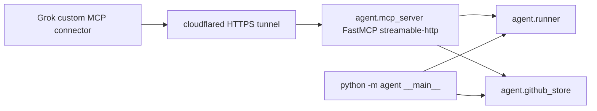

# Existing Python Agent invocation surface

Primary sources: `D:\AutoApply\agent\__main__.py`, `agent\mcp_server.py`, `agent\runner.py`, `run-grok.ps1`, `.env.example`, `AGENTS.md`, `agent\config.py` (env loading used by both entry points via imports).

## Summary

AutoApply exposes the same job-search operations twice: a **CLI** (`python -m agent <subcommand>`) and a **FastMCP HTTP server** (`python -m agent.mcp_server`) whose tools call the same `agent.runner` / `agent.github_store` functions. Grok is intended to use the MCP path after `run-grok.ps1` and a public tunnel; configuration lives in repo-root `.env` (see `.env.example`).

## CLI: `python -m agent`

Entry: `agent/__main__.py` — argparse subcommands, stdout is pretty-printed JSON (`ensure_ascii=False`). Errors return exit code `1` with `{"error": "<message>"}`.

| Subcommand | Arguments | Backend | Purpose (from `--help`) |
|------------|-----------|---------|-------------------------|
| `status` | — | `github_store.status()` | GitHub / local resume setup |
| `pull` | — | `runner.pull_resume()` | Pull master resume and profile from GitHub |
| `search` | `--keywords` (required), `--location` (default `Canada`), `--limit` (default `8`) | `runner.search_jobs(...)` | Web job search + match scoring |
| `ingest` | `--url` (required), `--title`, `--company` | `runner.ingest_url(...)` | Add one job URL and score |
| `matches` | `--min-score` (optional float) | `runner.list_matches(...)` | List jobs at/above score threshold |
| `tailor` | `--job-id` (required), `--force` | `runner.tailor(...)` | Tailor highlight wording + PDF |
| `push` | `--job-id` (required) | `runner.push_job(...)` | Push generated PDFs to GitHub |

Source: `agent/__main__.py`.

## MCP: `agent/mcp_server.py`

Server: **FastMCP** app name `"AutoApply"`, `stateless_http=True`, `json_response=True`. Server instructions (exposed to MCP clients): Canadian job-search agent; pull GitHub resume; search/ingest; score; tailor highlights only when match is high enough. Source: `agent/mcp_server.py` lines 13–21.

**Transport:** `mcp.run(transport="streamable-http", host=MCP_HOST, port=MCP_PORT)` in `main()`. Source: `agent/mcp_server.py` lines 71–72.

**Listen address / URL:**

- `MCP_HOST` default `0.0.0.0`, `MCP_PORT` default `8790` — read at module load in `mcp_server.py`.
- `run-grok.ps1` prints local MCP URL `http://127.0.0.1:8790/mcp`.
- `AGENTS.md` documents Grok custom connector at `https://<tunnel>/mcp` after `cloudflared tunnel --url http://127.0.0.1:8790`.

Each tool returns a **JSON string** (same payloads as CLI, via `_json()`).

| MCP tool | Parameters | CLI equivalent | Backend |
|----------|------------|----------------|---------|
| `resume_status` | — | `status` | `github_store.status()` |
| `pull_resume` | — | `pull` | `runner.pull_resume()` |
| `search_jobs` | `keywords`, `location` default `Canada`, `limit` default `8` | `search` | `runner.search_jobs(...)` |
| `ingest_job` | `url`, `title`, `company` | `ingest` | `runner.ingest_url(...)` |
| `list_matches` | `min_score` optional | `matches` | `runner.list_matches(...)` |
| `tailor_resume` | `job_id`, `force` default `False` | `tailor` | `runner.tailor(...)` |
| `push_application` | `job_id` | `push` | `runner.push_job(...)` |

Docstrings note: `tailor_resume` does not overwrite `master.pdf`; `push_application` uploads tailored resume and cover letter PDFs. Source: `agent/mcp_server.py`.

## Shared behavior (`agent/runner.py`)

Operations invoked by both surfaces:

- **`pull_resume`:** `github_store.pull()`.
- **`search_jobs`:** `scan_and_queue` then per-job enrich/score via JD extraction and `match.score_job`; persists with `upsert_job`.
- **`ingest_url`:** `add_job` with `source="agent"`, then same enrich/score path.
- **`list_matches`:** Default floor `config.MATCH_MIN_SCORE` unless `min_score` overridden; sorted by score descending.
- **`tailor`:** Raises `KeyError` if unknown `job_id`. If not `force` and score below `MATCH_MIN_SCORE`, returns `skipped: true` with reason (no PDF prep). Otherwise `prepare_job`.
- **`push_job`:** Uploads resume/cover paths via `github_store.push_application`.

Source: `agent/runner.py`.

## Required local process

From `run-grok.ps1` and `AGENTS.md`:

1. **Working directory:** repo root (`run-grok.ps1` sets location to script root).
2. **Virtualenv:** Create `.venv` if missing; `pip install -r requirements.txt`.
3. **Start MCP:** `.\venv\Scripts\python.exe -m agent.mcp_server` (via `run-grok.ps1`).
4. **Grok reachability:** Separate terminal — `cloudflared tunnel --url http://127.0.0.1:8790`; register Custom connector at `https://<tunnel>/mcp` on [grok.com/connectors](https://grok.com/connectors).
5. **CLI (optional):** Same venv — `python -m agent <subcommand>` without starting MCP.

`AGENTS.md`: user chat is in Grok, not Cursor; resume source of truth is `resume/master.pdf` on GitHub repo `826-Leoyu/AutoApply`; do not overwrite master or invent work history.

## Environment keys

Documented in `.env.example`; loaded for agent code via `load_dotenv(ROOT / ".env")` in `agent/config.py` when `config` is imported (both MCP and CLI import paths that pull in `config`).

| Variable | Default / example (`.env.example`) | Used by |
|----------|-------------------------------------|---------|
| `GITHUB_REPO` | `826-Leoyu/AutoApply` | `agent/config.py` — required with token for GitHub ops |
| `GITHUB_TOKEN` | placeholder | `agent/config.py` |
| `GITHUB_BRANCH` | `main` | `agent/config.py` |
| `GITHUB_RESUME_PATH` | `resume/master.pdf` | `agent/config.py` |
| `GITHUB_PROFILE_PATH` | `profile.json` | `agent/config.py` |
| `GITHUB_OUT_PREFIX` | `applications` | `agent/config.py` |
| `MATCH_MIN_SCORE` | `55` | `agent/config.py`; affects `list_matches` default and `tailor` skip logic |
| `MCP_HOST` | `0.0.0.0` | `agent/mcp_server.py` only |
| `MCP_PORT` | `8790` | `agent/mcp_server.py` only |

`configured()` in `agent/config.py` is true only when `GITHUB_REPO` and `GITHUB_TOKEN` are both set.

## Architecture (as implemented)

Both entry points are **in-process Python calls** into `runner` / `github_store`, not subprocess wrappers around the CLI.
